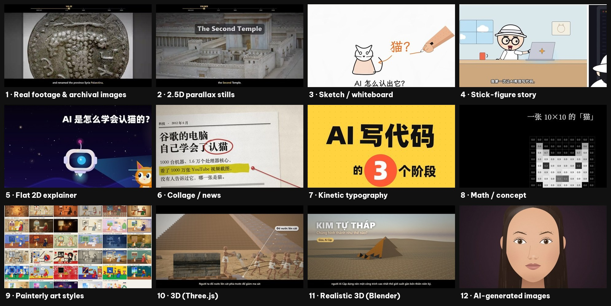
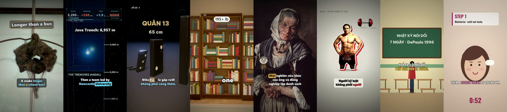
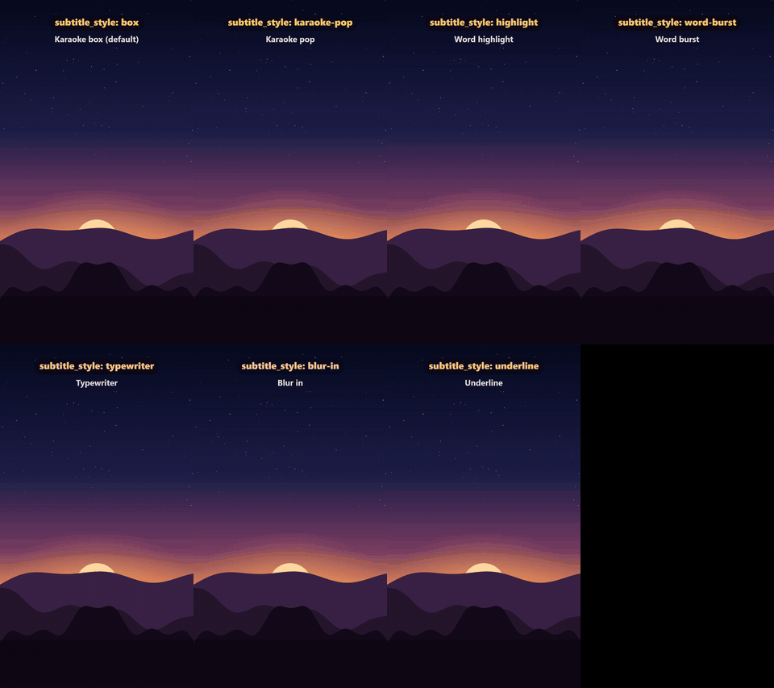
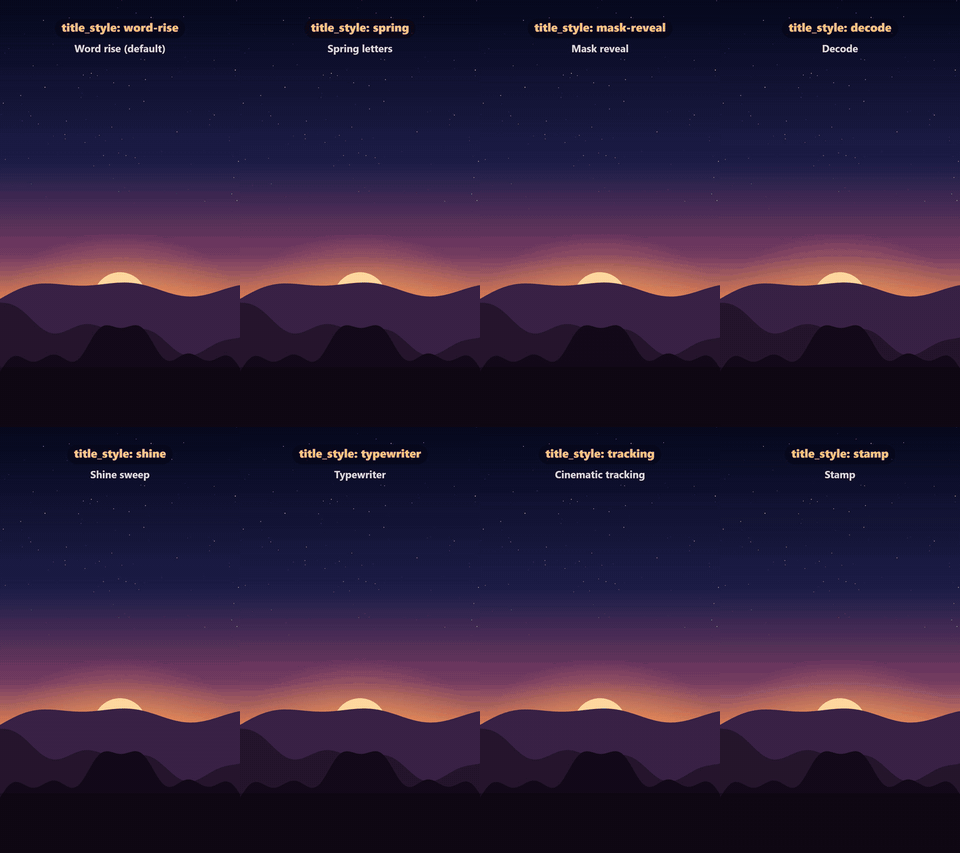
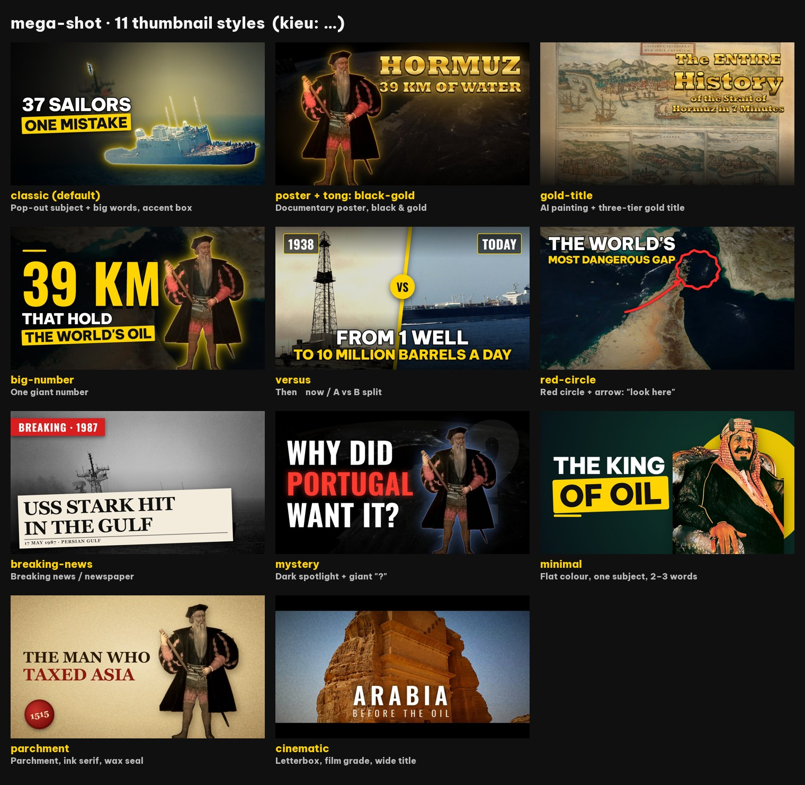
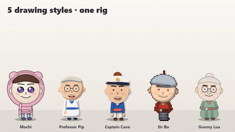
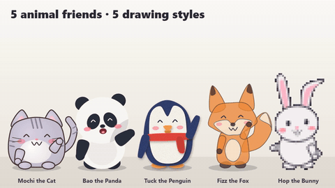
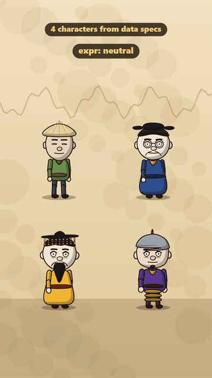

# mega-shot — type an idea, get a finished video

mega-shot turns a request like *"make a 90-second vertical video about why the sea is salty"* into a finished,
publish-ready video: researched script → cloned narration voice → visuals in the style you pick → karaoke subtitles →
music and sound effects → high-quality export + phone preview → automatic quality checks → titles, description,
hashtags, chapters, subtitles (SRT) and thumbnails.

It works two ways:

- **As a Claude Code skill** (recommended): just say what video you want — Claude researches, writes, builds and checks it for you
  (behind the scenes it writes the video's script file, `video.yaml`, and runs the `xp` CLI).
  Other coding agents (Codex, Cursor, Gemini CLI, …) can use it through [`AGENTS.md`](AGENTS.md).
- **As a plain CLI**: write the script file (`video.yaml`) yourself and run `xp narrate → xp render → xp export`.



## Features

| | |
|---|---|
| **One file per video** | `video.yaml` (script + settings) + `film.html` (how scenes are drawn). English or the original Vietnamese keys. |
| **Narration** | Local voice cloning and TTS through [VoiceStudio](https://github.com/debpalash/VoiceStudio) (headless), any language; built-in English narrators; or import your own recordings. Every line is listened back (Whisper) and re-generated if words are dropped. |
| **Visual styles** | Real footage & archival images (auto search, scoring and smart crop from Pixabay/Pexels/NASA/…), 2.5D parallax, sketch/whiteboard, flat 2D, collage, kinetic typography, math/concept, 35 painterly styles, Three.js 3D, Blender photoreal, AI images, code-drawn cartoon characters, news motion graphics, satellite "evidence" scenes. |
| **Text** | 7 animated subtitle styles + 8 title styles, word-timed karaoke, labels synced to narration, CJK/Thai wrapping. |
| **Sound** | Automatic SFX, beat-aware music looping, ducking, original per-video scores (ABC notation), −14 LUFS normalisation. |
| **Rendering** | Per-scene cached rendering (fix one scene, re-render one scene), GPU H.264 in the browser (WebCodecs), x264 fallback. |
| **Quality gates** | Script score, review before render (dropped words, subtitle ≠ speech, text off-frame), cut self-check (flashes, black dips, frozen frames, clicks, clipped endings). |
| **Publishing** | YouTube package (titles, description, chapters, tags, credits), TikTok/Reels captions, thumbnails in 11 styles, English SRT always, multi-episode series → one long video. Optional YouTube channel automation (private uploads, official API) and a pluggable social-posting adapter. |
| **Licences** | Every downloaded asset is logged with its licence and credited automatically. Downloads only from sources you approve. |
| **Studio** | Local web dashboard (`xp studio`, 127.0.0.1 only): every video, one-click steps, edit lines, pick footage, play results. |

## Gallery

### Made with mega-shot

Real frames from videos produced end-to-end with mega-shot — footage with live captions, a 3D depth HUD, code-built 3D,
a 3D product cutaway, old paintings in 2.5D, manifesto typography, stick-figure stories and flat 2D explainers.



### Animated subtitles & titles

Word-timed karaoke subtitles (7 styles) and title animations (8 styles), springs and easing driven by the narration.
Works in any language — the preview below is Vietnamese, with full diacritics.

| Subtitle styles | Title styles |
|---|---|
|  |  |

### Thumbnails that get clicked

Eleven thumbnail styles — cut-out subject, big words, versus, red circle, breaking news, poster, cinematic and more.



### Characters, drawn in code

Cartoon characters with poses, expressions and lip-sync — no image AI needed. One rig, many drawing styles, plus animal
mascots and 3D people for history and explainer scenes.

| Drawing styles · one rig | Animal friends |
|---|---|
|  |  |

| Talking characters | 3D people |
|---|---|
|  |  |

## Requirements

| | Required? | Notes |
|---|---|---|
| [uv](https://docs.astral.sh/uv/getting-started/installation/) | **yes** | runs every command; installs Python packages on demand |
| [FFmpeg](https://ffmpeg.org) on PATH | **yes** | `xp setup --install ffmpeg` (winget / Homebrew / apt-dnf-pacman) |
| Chromium for Playwright | **yes** | `xp setup --install chromium` (~180 MB) |
| [VoiceStudio](https://github.com/debpalash/VoiceStudio) | for narration | `xp setup --install voicestudio` (official release, SHA-256 verified). Without it: `xp narrate --import-from <folder of seg1.wav, seg2.wav…>` |
| NVIDIA GPU | recommended | faster narration and encoding; everything also runs on CPU |
| Pixabay API key (free) | for the footage style | `PIXABAY_API_KEY` in `.env` |
| Node.js | optional | 3D templates (`--install three`), news graphics (`--install hyperframes`), original music (`--install composer`) |
| Blender | optional | photoreal 3D template (`MS_BLENDER` or on PATH) |
| [Claude Code](https://claude.com/claude-code) | optional | to use mega-shot as a skill |

Tested on Windows 11. macOS and Linux work for the core pipeline (setup handles FFmpeg, VoiceStudio and Chromium there too).

## Install

```bash
# A) as a personal Claude Code skill (available in every project)
git clone https://github.com/stevenguyenbt/mega-shot ~/.claude/skills/mega-shot

# B) or inside one project
git clone https://github.com/stevenguyenbt/mega-shot <project>/.claude/skills/mega-shot
```

Then, **from your project folder** (any empty folder works — it will hold `.mega-shot/` and `videos/`):

```bash
~/.claude/skills/mega-shot/xp setup          # Windows: %USERPROFILE%\.claude\skills\mega-shot\xp.cmd setup
```

`xp setup` checks everything, starts VoiceStudio if it is installed, and prints **NEEDS YOUR INPUT** — the items you
decide on. Nothing large is installed without your approval: run `xp setup --install chromium,fonts` (etc.) for what
you want, and `xp setup --policy` once you agree to automatic licensed downloads. Put your keys in `.env`
(copy [`.env.example`](.env.example)). Tip: add `alias xp=~/.claude/skills/mega-shot/xp` to your shell profile.

With Claude Code, just open the project and ask for a video — copy [`docs/CLAUDE.project.md`](docs/CLAUDE.project.md)
into your project's `CLAUDE.md` so the AI always runs setup and asks the style first.

## Your first video in 5 minutes

No API keys and no voice model needed — this uses the blank Canvas template and a recording you make yourself.

```bash
cd my-project
xp setup --install chromium                  # once
xp new hello --template blank --format 9x16
cd videos/hello
```

Edit `video.yaml` (English keys):

```yaml
name: hello
format: 9x16
language: en
scenes:
  - id: opening
    heading: Hello, mega-shot
    narration: This is my first video made with mega-shot.
  - id: main-idea
    heading: One file, one video
    extra: 1.5
    narration: Everything you see comes from a single YAML file.
```

Record one WAV per scene (`seg1.wav`, `seg2.wav` in a folder — or let VoiceStudio narrate with `xp narrate`), then:

```bash
xp narrate --import-from ~/recordings/hello   # or: xp narrate   (VoiceStudio)
xp preview                                    # look at build/thu.jpg
xp mix && xp render && xp export && xp check
```

Result: `out/hello_9x16.mp4` (upload quality), `out/hello_9x16_xem_thu.mp4` (phone preview), publishing notes in
`out/`. Next: [docs/getting-started.md](docs/getting-started.md) for the real-footage workflow with research,
fact-checking, stock search and thumbnails.

## How it works

```
video.yaml ──► xp narrate ──► build/audio/*.wav + word timestamps ──► build/timeline.json
     │              (VoiceStudio TTS, Whisper listen-back)                  │
     ├──► xp assets / art / hf / blender ──► footage, drawn layers, 3D, graphics
     │                                                                      ▼
film.html + engine/ (Canvas 2D · Three.js · stills · text FX) ──► xp render (headless Chromium, per-scene cache, WebCodecs)
     │                                                                      ▼
xp mix (voice + music + SFX, −14 LUFS) ──► xp export (upload file + preview + publish pack + SRT) ──► xp check
```

Details: [docs/architecture.md](docs/architecture.md).

## Documentation

| | |
|---|---|
| [docs/getting-started.md](docs/getting-started.md) | full workflow, step by step |
| [docs/cli.md](docs/cli.md) | every command (English names + old Vietnamese aliases) |
| [docs/yaml-reference.md](docs/yaml-reference.md) | `video.yaml` / `loat.yaml` keys — English ↔ Vietnamese table |
| [docs/configuration.md](docs/configuration.md) | project folder, `.env`, download policy, environment variables, optional components |
| [docs/architecture.md](docs/architecture.md) | how the pieces fit, file layout, writing your own `film.html` |
| [docs/social-posting.md](docs/social-posting.md) | `xp social` adapters (folder, webhook, your own module) |
| [docs/faq.md](docs/faq.md) | FAQ and troubleshooting |
| [SKILL.md](SKILL.md) + [references/](references/) | the detailed manual the AI reads (styles, voice, thumbnails, series, 3D, story films, music, …) |

## FAQ (short)

- **Why are some names Vietnamese?** The project was built in Vietnamese. Every command, flag and YAML key now has an
  English name; the Vietnamese names still work so existing videos never break. Some internal file names
  (`build/thu.jpg` = preview sheet, `giay_phep.json` = licence book) are explained in [docs/yaml-reference.md](docs/yaml-reference.md).
- **Does it need the cloud?** No. Everything runs locally; network is used only for stock search/downloads you allow,
  and optional APIs (YouTube, your own posting adapter).
- **Can I use my own voice?** Yes — `xp voice add <audio-or-video> --name me --consent` (only voices you own or have permission to clone).
- More in [docs/faq.md](docs/faq.md).

## Credits

mega-shot stands on the shoulders of these open-source projects — thank you:

- **[huashu-art-motion](https://github.com/alchaincyf/huashu-art-motion)** by alchaincyf (MIT) — the drawn explainer
  grammars (whiteboard, stick-figure story, flat 2D, collage, kinetic typography, math/concept) and the 35 painterly art
  styles shown in the style gallery (styles 3–9).
- **[huashu-motion](https://github.com/alchaincyf/huashu-motion)** by Huashu (MIT) — the motion-language library
  (`references/chuyen-dong/`) and the ABC-notation composer used by `xp nhac`.
- **[lemo-opuscar](https://github.com/lemomo-ai/lemo-opuscar)** by LemoLab (MIT) — the Evidence Films styles and director guide (`references/evidence/`).
- **[img2threejs](https://github.com/img2threejs/img2threejs)** (Apache-2.0) — ideas for the 3D material/geometry kit and reference-review workflow.
- **blender-skills** contributors (MIT) — Blender craft guides (`references/blender/`).
- **[VoiceStudio](https://github.com/debpalash/VoiceStudio)** (AGPL-3.0, separate program), **[three.js](https://threejs.org)**,
  **[Playwright](https://playwright.dev)**, **[FFmpeg](https://ffmpeg.org)**, **[faster-whisper](https://github.com/SYSTRAN/faster-whisper)**,
  **[HyperFrames](https://github.com/heygen-com/hyperframes)**, **[uv](https://github.com/astral-sh/uv)**.
- Footage and images in the galleries come from open sources (Pixabay, NASA and other public-domain archives, Wikimedia Commons).

Full list with licences: [THIRD_PARTY_NOTICES.md](THIRD_PARTY_NOTICES.md).

## Contributing & licence

Contributions welcome — see [CONTRIBUTING.md](CONTRIBUTING.md), [CODE_OF_CONDUCT.md](CODE_OF_CONDUCT.md) and
[SECURITY.md](SECURITY.md). mega-shot is released under the [MIT licence](LICENSE). Assets, voices and music you put in
your videos keep their own licences — mega-shot logs them, you are responsible for respecting them.

## Support

mega-shot is free and will stay free. If it saved you a few hours of editing and you'd like to say thanks,
you can [buy me a coffee ☕](https://buymeacoffee.com/lestinguye9) — completely optional.
A ⭐ on the repo, a bug report, or sharing a video you made with it helps just as much. Thank you!
