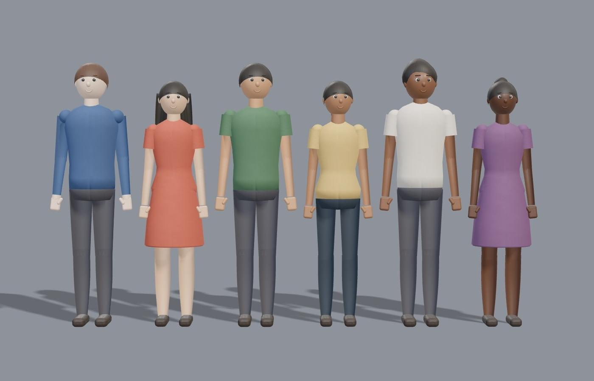
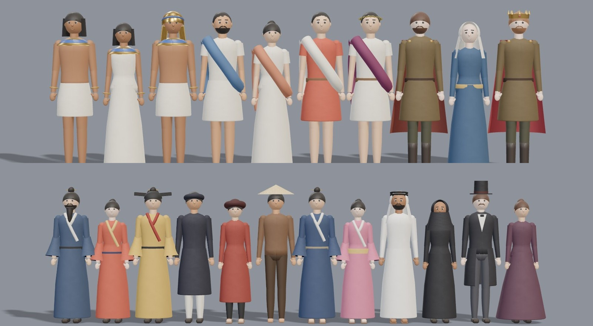

# 3D quality kit + reusable model library

Three files under `engine/backends/three/` make every stylised 3D scene look less like flat plastic. The patterns and material priors are adapted from **img2threejs** (Apache-2.0, https://github.com/img2threejs/img2threejs). This is a short form of its pipeline: no npm install, no rigging stage, 2–3 review passes instead of 5–8.

| File | What it gives |
|---|---|
| `mats3d.js` | `mat3d(preset, overrides)` → `MeshPhysicalMaterial` with procedural, tileable micro-variation on colour, roughness and bump (seeded, deterministic). Presets: `wood`, `wood-varnish`, `wood-toy`, `steel`, `brushed-steel`, `iron`, `aluminium`, `copper`, `brass`, `bronze`, `gold`, `stone`, `marble`, `earth`, `snow`, `fabric`, `silk`, `velvet`, `skin`, `fur`, `leather`, `glass`, `frosted-glass`, `water`, `plastic`, `matte-plastic`, `ceramic`, `paper`, `wax`, `honey`, `coal`. Overrides: `color`, `repeat: [u, v]`, `vary`, `bump`, `seed`, any material param. |
| `geo3d.js` | `roundedBox` (real bevels, so edges catch the light) · `lathe(profile)` (vases, spindles, bulbs, pedestals) · `fluted` (column with flutes and entasis) · `taper(points, radius(u))` (tails, horns, hair locks, roots; parallel-transport frames, pointed tip; never use a constant tube for these) · `plate(shape, depth, {bevel})` (bevelled silhouettes: anvils, signs, leaves) · `blade(len, w, thick)` (thickness tapers from spine to edge) · `scatter(geo, mat, n, place)` (instancing for rivets, pebbles, crowds) · `lump(r, k)` (rocks, bread, fruit). |
| `library3d.js` | Loads models from `<project>/.mega-shot/models3d/<name>/model.js` and makes independent instances: `instance(name, { cao, goc })`. |

`sets3d.js` (template `triet-ly`) and `props3d.js` (`vat3d` in the footage and tuyen-ngon templates) use these by default:
- physical materials;
- soft VSM shadows (radius 7, 16 samples);
- RoomEnvironment reflections, so metal and glass read correctly.

## Rules (from the img2threejs grimoire)
- **Metal:** metalness 1, and the tint goes in the colour. Paint and plastic stay dielectric (metalness 0).
- Bright environments wash out coloured coats, so use `envMapIntensity` ≈ 0.7 for dielectrics.
- Purples must lean magenta (R ≳ B) or they turn blue in shadow.
- Bevel radius ≈ 2–8 % of the smallest side, 2–4 segments.
- Parts overlap by 0.02–0.05 so nothing floats.
- Keep the root scale at 1.
- Judge every model under neutral, grazing and reference-matched light before calling it done.
- **Transmission glass only refracts OPAQUE objects:** liquid, sand or a flame inside glass must be opaque (or MeshBasic) or it disappears / turns milky. (Learned on an oil-lamp model.)
- AgX tone mapping desaturates warm colours: pick liquids and golds a step deeper than the reference.

## Model library — `xp model`

Build each object you will reuse **once**; every later video gets it for free. The library lives in your project (`.mega-shot/models3d/`) and starts empty — no models ship with the skill.

```
xp model new <name> --from pixabay:<id> [--height 1]      # or --from <image> --license "owner / permission"
#   → .mega-shot/models3d/<name>/ref.jpg, meta.json, NOTES.md (detail inventory), model.js (starter)
xp model check <name> [--time 1.2]                         # → review.jpg: REFERENCE | FRONT | THREE-QUARTER | SIDE | GRAZING
xp model list
```

### Loop (about 10–15 min per object)
1. Look at `ref.jpg` and fill `NOTES.md`:
   - silhouette and proportions;
   - one line per part: primitive, size relative to the height, material preset, colour hex;
   - only the details that read at video size.
2. **Pass 1, blockout and form:** write `model.js` with `geo` + `mat3d`. Run `xp model check` and compare the FRONT view with the reference silhouette.
3. **Pass 2, fix:** proportions, bevels and tapers, material colour and roughness. Check the GRAZING view for surface relief. Log each pass in `NOTES.md`.
4. Stop when the silhouette, palette and key features read as the reference. One more pass only if something is clearly wrong.

### model.js contract
```js
export const meta = { name, height: 1, ref: 'ref.jpg', source, license };
export default function build({ THREE, mat3d, geo, o }) {
  const group = new THREE.Group();           // sits on y = 0, faces +z
  …
  return { group, update(s) { /* s = { t, lt, D, u } — animate named pivots, sand, flames… */ } };
}
```

### Using models in videos
- **Template `triet-ly`:**
  - `canh3d: { kieu: vat, ten: dong-ho-cat, cao: 2 }` shows the model on a marble pedestal with a turntable and orbiting camera.
  - `canh3d: { kieu: so-tay, them: [{ ten: dong-ho-cat, x: 1.15, z: -1.25, cao: 1.1, xoay: .4 }] }` adds the model to any set.
- **Templates `footage` / `tuyen-ngon`:** `vat3d: { ten: dong-ho-cat, x: .5, y: .3, co: .6 }` (or `kieu: "lib:dong-ho-cat"`) places it as a prop over the footage.
- Templates preload the referenced models automatically (`S.preload(TL)`).

Example: a wooden hourglass rebuilt from one Pixabay photo took 2 passes; its sand runs with `s.u` (scene progress).

## When to use something else
- **Photoreal object seen from every side:** Tripo (`tools/tripo.py`, costs credits).
- **Keep the real photo itself:** 2.5D layers (`MS.still25`) in the footage template.
- **Full img2threejs** (rigged characters, 5–8 gated passes, 80k–180k tokens per object): only for a hero asset the user explicitly asks for, and only after they approve installing it.

## Stylised 3D people — `people3d.js`



`person({ gioi, da, toc, mau_toc, ao, quan, vay, tay_ao, giay, cao, size })`:
- **Body:** male / female proportions (shoulders, hips, height 1.76 / 1.64).
- **Skin `da`:** 6 tones, `1` light → `6` deep.
- **Hair `toc`:** `ngan` short, `dai` long, `buoc` ponytail, `bui` bun, `xoan` curly, `troc` bald.
- **Hair colour `mau_toc`:** `den`, `nau`, `nau-nhat`, `vang`, `do`, `bac`, or a hex.
- **Clothes:**
  - `ao` shirt colour (hex) and `quan` trouser colour (hex);
  - `vay: true` for a dress;
  - `tay_ao: dai | ngan` (long or short sleeves, with bare forearms for short).
- **Face:** stylised eyes with iris, brows, nose, smiling mouth, ears.
- **Joints:** elbow and knee pivots (`aL.lo`, `lL.lo`). The walk cycle bends the knees and elbows.

`person.random(seed, { gioi })` makes a varied spec for crowds and chains of generations.

It uses the same rig API as the wooden mannequin, so every set in `sets3d.js` can use it.

**In template `triet-ly`:**
- `phong_cach: { nguoi3d: true }` turns every figure into a person, with varied genders and skin tones per scene. Pass `{ gioi: nu }` etc. instead of `true` to bias the random specs.
- `canh3d: { kieu: binh-minh, nguoi: { gioi: nu, da: 5, toc: buoc, ao: 0xb8432f, vay: true } }` fixes the main figure of that scene.
- In library models, `build({ person })` is available (a line-up model of several people is a good review sheet).

**Rules learned:**
- No visible joint spheres. Overlap the next segment instead, or they read as a wooden doll.
- A lathe skirt profile must go bottom → top, or it renders inside-out (like a cape).
- Short sleeves are a closed cylinder over a skin-coloured upper arm.
- Keep the fringe above the eyes (cap tilted back about 0.55 rad).

### Period costumes (`thoi_dai`, `vai`)



| `thoi_dai` | Man | Woman | `vai: vua` |
|---|---|---|---|
| `hien-dai` | shirt + trousers | shirt + trousers / dress | — |
| `ai-cap` | bare chest, white kilt (shendyt), broad gold collar, black bob wig, sandals | white sheath dress, collar, wig | nemes headdress |
| `ba-tu` | Achaemenid court robe with `xu` sleeves (cloth hanging under the arm), sash, square curled beard (`rau: vuong`), hair bunched at the nape (`toc: bui-gay`), fluted tiara (`mu-ba-tu`) | robe, veil | crenellated gold crown (`vuong-mien-ba-tu`) |
| `hy-lap` | short chiton + blue himation drape, short curls, beard, sandals | long chiton + drape, bun | laurel wreath |
| `la-ma` | red tunic + white toga drape, belt | long stola + drape | laurel + purple toga |
| `trung-co` | tunic, belt, cape, boots, beard | long gown, veil | crown + red cape |
| `trung-hoa` | robe with wide sleeves, crossed collar (giao lĩnh), sash, topknot | robe, wide sleeves, bun | official cap with wings (mũ cánh chuồn) |
| `viet-nam-xua` | black áo dài + white trousers + khăn xếp | red áo dài + khăn vấn | court robe + official cap |
| `nhat-ban` | kimono, topknot | kimono + wide obi | — |
| `a-rap` | white thobe + ghutra with black agal, beard | black abaya + hijab | — |
| `the-ky-19` | frock coat, shirt front + cravat, top hat, moustache | long dress, bun | — |

- `vai: nong-dan` gives the peasant look of an era: brown áo nâu, nón lá, barefoot.
- Any field overrides the preset, for example `{ thoi_dai: trung-hoa, rau: dai, mau_toc: bac }` for an old sage.
- Crowds: `person.random(seed, { thoi_dai })` keeps the era costume, varies the colours inside the era palette and uses the era's skin range.
  - East Asia, Egypt and Arabia: black hair.
  - Europe: varied hair colours.
- **In sets:** use `canh3d: { kieu: the-he, thoi_dai: trung-hoa }` for every figure in the scene. Use `canh3d.nguoi: { thoi_dai, vai, … }` for the main figure.
- **Line-up review:** build one library model that lines up one figure per era preset and check it with `xp model check` after changing `people3d.js`.

**More rules learned:**
- `geo3d.taper` must wind outward. It used to wind inward, which turned drapes into thin stripes and hollowed out hair and tails.
- Wide sleeves need a dark matte (Lambert) lining and must stop above the wrist. Fabric sheen on back faces, or pale hands deep inside a dark bell, glow under bloom.
- Skin has no clearcoat (hot glare under spotlights).

## People from a reference image (rule for every video with people)

Whenever a video shows people (a historical figure, a profession, a costume, a recurring narrator character), build each recurring character from a **reference image**. Do not rely on the era preset alone.

1. **Find a reference** per character:
   - the user's own image (`--license` = who owns it);
   - Pixabay (`--from pixabay:<id>`);
   - Wikimedia portraits or statues only when this video is allowed (`nguon_them`), or the user agrees.
   
   For historical figures, use period paintings or statues. They give the costume, hair and colours.
2. Run `xp model new <id> --from … --nguoi`. This writes `ref.jpg`, a character sheet `NOTES.md` and a starter `model.js` that exports `nguoi` (the people3d spec) and `chi_tiet(F, …)` (custom pieces).
3. Fill `NOTES.md` from the image: gender, age, skin, hair (length → `do_dai_toc`), beard, headwear, garment layers and colours (hex from the image), footwear, signature details.
4. Write `nguoi`: start from the closest `thoi_dai` preset, then override. Missing pieces go into `chi_tiet()`: emblems, jewellery, bouquets, weapons, patterns. Attach them to `F.B`, `F.head` or `F.aL.lo`. If a piece will be reused by other characters, add it to `people3d.js` as a new option, as was done for `xe_ta` (áo dài side slits) and `do_dai_toc`.
5. Run `xp model check <id>`. The sheet shows REFERENCE | FRONT | THREE-QUARTER | SIDE | BACK | GRAZING. Do 2–3 passes and log them in `NOTES.md`.
6. Use the character in scenes:
   - `canh3d: { …, nguoi: <id> }` for the main figure;
   - `nguoi_khac: [<id>, { spec }, …]` for the next figures;
   - the rest of the scene can follow `thoi_dai`.
   
   The rig keeps walking and posing.

The result is a stylised costume study, not a likeness. Never try to reproduce a living private person's face, and never recreate another channel's characters.

Example: a young woman in an ivory áo dài with a nón lá (Vietnamese long dress and conical hat), long black hair and a lily bouquet, rebuilt from one Pixabay photo in 2 passes.

Historical rulers work well from reliefs and statues (e.g. Persian kings from the Persepolis and Pasargadae reliefs on Wikimedia; keep the attribution in each `meta.json`). Wide ancient-world map for these videos: `vat3d: { kieu: ban-do-co, vung: persia | parthia | sasanian, ghim: [...], tuyen: [[city, [lon, lat], …]], nhan: "TITLE", tam: [lon, lat], ty_le }` (props3d.js).
