# Animated subtitle & title styles (textfx)

Motion uses physics springs and time interpolation: the same model as Remotion's `spring()` / `interpolate()` (damping, stiffness, mass). It is implemented in our own `engine/core/textfx.js`, with no Remotion code or dependency. Every style is driven by the word-level timestamps from `xp narrate`, so the highlight follows the voice exactly.

**Show the user the previews before choosing.** Do it in Step 0, together with the visual style: send `references/text-styles/overview-subtitles.gif` and `overview-titles.gif`, then ask with `AskUserQuestion`. Single-style GIFs are listed below. After editing textfx.js, regenerate them with `xp text-styles` (or `--only highlight,spring`).

## Use in video.yaml

```yaml
style: { subtitle_style: highlight, title_style: spring }   # whole video (Vietnamese key: phong_cach)
scenes:                                                      # canh
  - id: ending
    title: What do you think?                                # chu
    title_style: stamp                                       # this scene's title only
```

- **Apply changes:** after changing these keys, run `xp timeline` (or `xp narrate`) so the style reaches `build/timeline.json`, then run `xp preview`.
- **Defaults:** omit both keys and nothing changes. Subtitles default to `box`, titles to `word-rise`.
- **Old keys:** `phu_de` / `chu_kieu` and the old Vietnamese ids (`nen-tu`, `lo-xo`, `dong-dau`…) are still accepted.
- **Colours:** they come from `phong_cach`:
  - `accent`: highlight pill, underline, stamp frame;
  - `subHot`: the word being spoken;
  - `subKey`: keywords and numbers, marked with `**…**` in `phu_de`.
- **Width:** titles auto-shrink to stay clear of the TikTok button column.
- **Older videos:** if a video was made before textfx, add `<script src="/ms/core/textfx.js"></script>` after overlay.js in its film.html. For `chu`, use `MS.title(…, c.data.title_style)` instead of `MS.words`.

## Subtitles: `phong_cach.subtitle_style`

| id | Look | Best for | Preview |
|---|---|---|---|
| `box` | dark box, current word yellow (default) | anything; safest legibility | 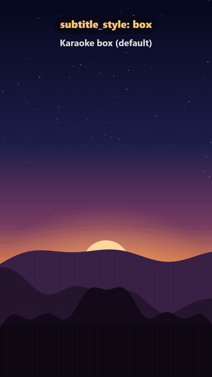 |
| `karaoke-pop` | no box, thick outline, spoken word springs up, unspoken words dim | TikTok/Reels, energetic | 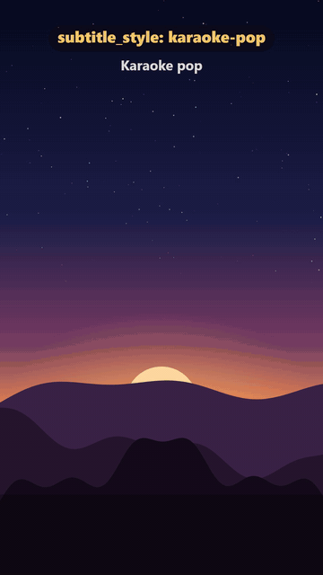 |
| `highlight` | accent pill springs from word to word | trendy shorts, motivation, lists | 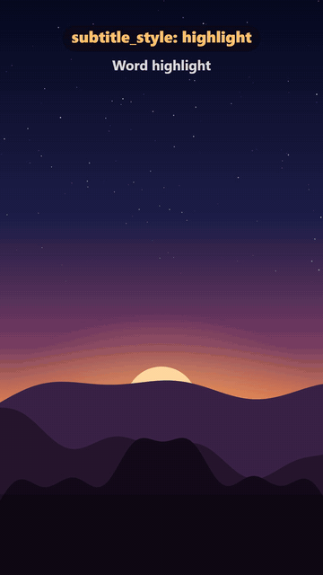 |
| `word-burst` | 1–3 big words at a time pop in | fast hooks, motivation speeches | 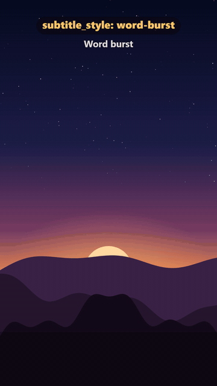 |
| `typewriter` | typing in a box with a blinking cursor | tech, mystery, letters | 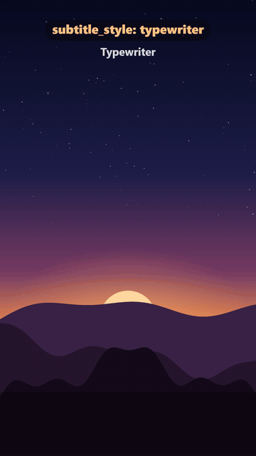 |
| `blur-in` | each word rises from blur over a soft dark band | documentary, space, contemplative | 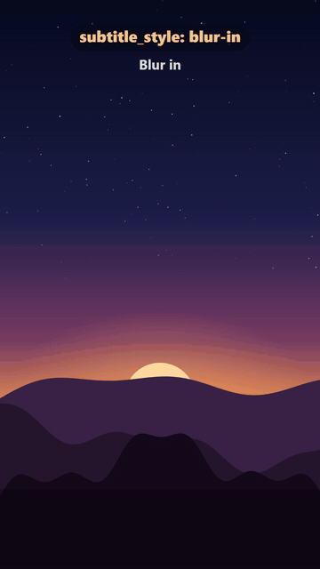 |
| `underline` | clean white text, accent underline follows the voice | explainers, history, calm | 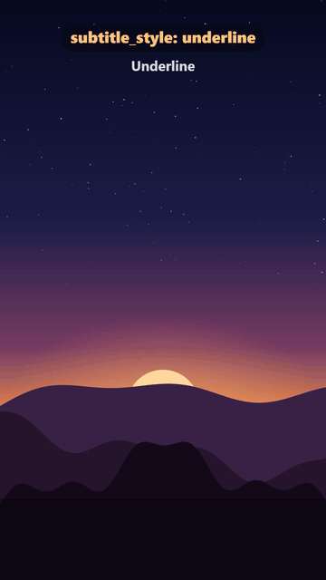 |

## Titles: `phong_cach.title_style` / scene `title_style`

| id | Look | Best for | Preview |
|---|---|---|---|
| `word-rise` | words rise one by one (default) | anything | 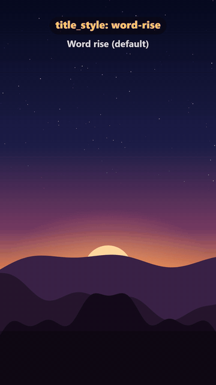 |
| `spring` | each letter springs in with a bounce | playful, kids, upbeat | 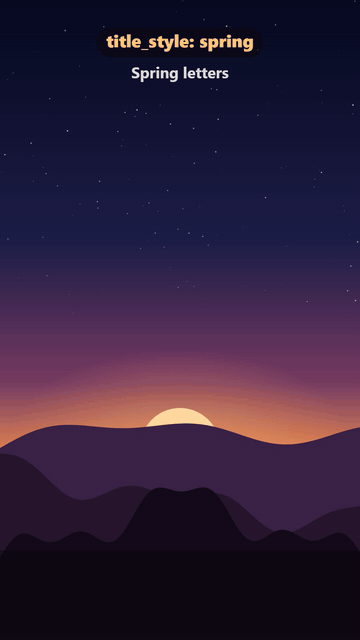 |
| `mask-reveal` | text slides up from behind a mask, accent bar draws under it | documentary chapters, history | 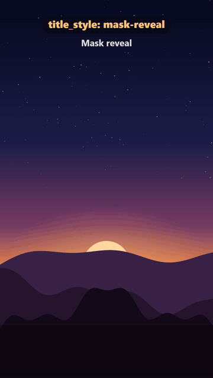 |
| `decode` | random glyphs decode into the title | tech, mystery, science | 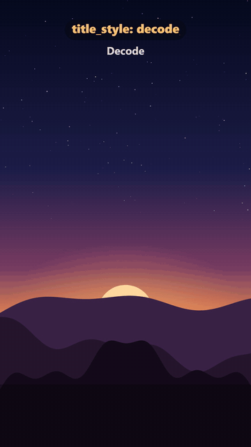 |
| `shine` | a light sweep passes over the text (every 3.2 s) | premium, space, luxury | 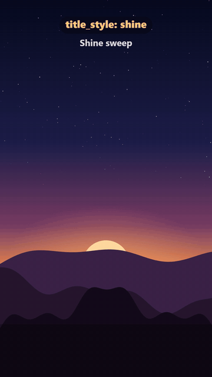 |
| `typewriter` | typing with a cursor | quotes, letters, timelines | 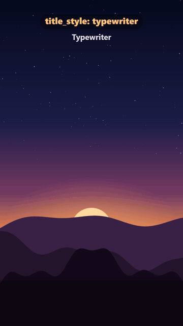 |
| `tracking` | wide blurred letter spacing tightens into sharp text | cinematic openings | 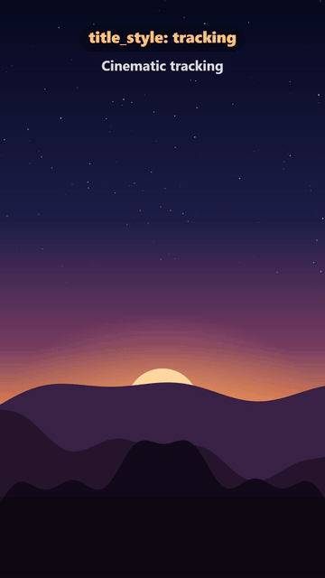 |
| `stamp` | slams down from 2.6×, shakes, flashes, accent frame | countdown numbers, shock facts, endings | 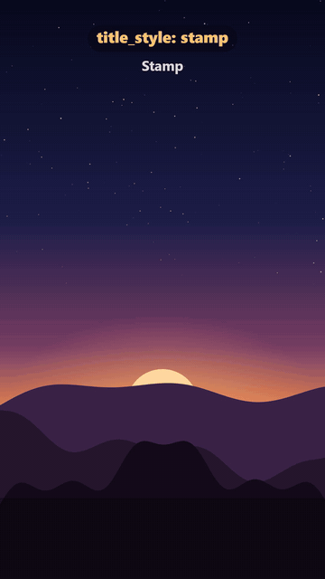 |

## Good pairings

| Video type | `subtitle_style` | `title_style` |
|---|---|---|
| Motivation / speech | `word-burst` or `highlight` | `stamp` (key line), `tracking` |
| Science / space / documentary | `blur-in` or `underline` | `shine`, `mask-reveal` |
| Countdown / top-N | `karaoke-pop` | `stamp` for each number |
| History / long YouTube | `box` or `underline` | `mask-reveal` |
| Tech / mystery | `typewriter` | `decode` |

Keep effects subtle. Use one subtitle style for the whole video and at most two title styles, for example `tracking` for every scene and `stamp` for the last one.

## API (custom film.html)

- `MS.title(x, text, X, Y, t0, lt, size, col, style)` draws a title. `lt` is scene time; `t0 < 0` means visible from frame 0.
- `MS.subtitle` dispatches to `MS.tfx.SUB[subtitle_style]`.
- For your own animations: `MS.tfx.spring(t, { damping, stiffness, mass })` and `MS.tfx.interp(v, a, b, o0, o1, ease)`.
- Include `<script src="/ms/core/textfx.js"></script>` after overlay.js. All templates already do.
